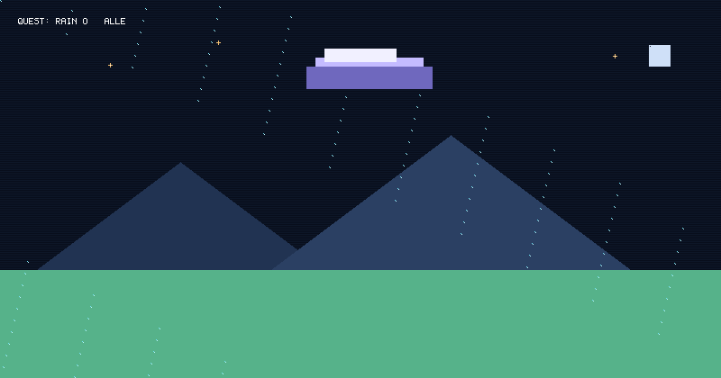

# Rainy-day profile animation

Copy `rain_game.py`, `scene.py`, `image_export.py`, `theme.py`, and the `assets/` folder into the root of your GitHub profile repository. Keep the generated image files in `assets/`.

Run the generator from the repository root whenever you want to update the animation:

```bash
python rain_game.py
```

Add this to the profile `README.md`:

```markdown

```

The generator also creates a static poster at `assets/rainy-day-quest.png`. Use this image instead of the GIF when you want a still, motion-free profile:

```markdown

```

## Design rationale

- A deep indigo sky, soft lavender cloud, and warm umbrella keep the palette restrained and make the character easy to spot.
- Pixel-shaped rain, mountains, puddles, and HUD panels give the image a coherent game-screen feel at README scale.
- The cloud's gentle float and the adventurer's small steps add life without busy camera movement or flashing effects.
- The static poster uses the same first frame, so a motion-free profile retains the same composition.

## Animation timings

- **GIF:** 40 frames at 90 ms each; a 3.6-second seamless loop.
- **Cloud:** one smooth sine-wave drift per loop, moving up to 9 px sideways and 4 px vertically.
- **Rain:** drops fall 8–10 px per frame and wrap back below the cloud.
- **Adventurer:** a small side-to-side sway over the full loop, with alternating legs every 360 ms.

## Accessibility and responsive behavior

- The README image has descriptive alt text. It is decorative and has no controls or keyboard interaction.
- Animated GIFs play automatically in many README viewers. The supplied PNG is the motion-free alternative; choose it for a reduced-motion profile.
- The 800 × 420 image scales down with the README column while preserving its aspect ratio. Its large shapes and short pixel labels are designed to remain legible at smaller widths.

## Files

- `rain_game.py` — command-line entry point.
- `scene.py` — pixel canvas and game scene drawing.
- `theme.py` — palette, dimensions, and bitmap font.
- `image_export.py` — standard-library GIF and PNG encoders.
- `assets/rainy-day-quest.gif` — animated profile image.
- `assets/rainy-day-quest.png` — static poster for reduced motion.

No third-party Python packages are required.
